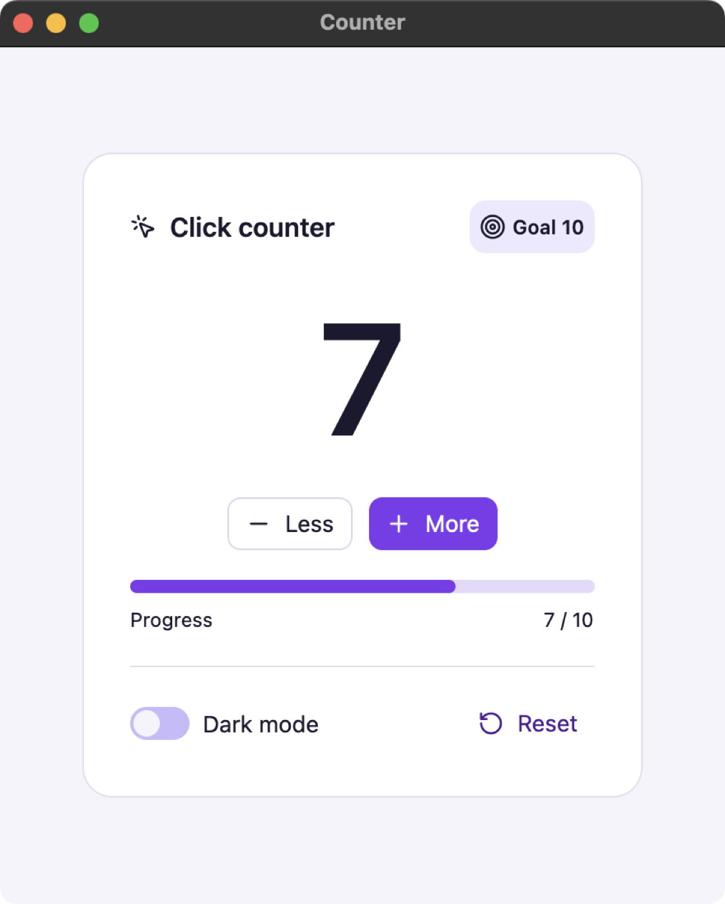
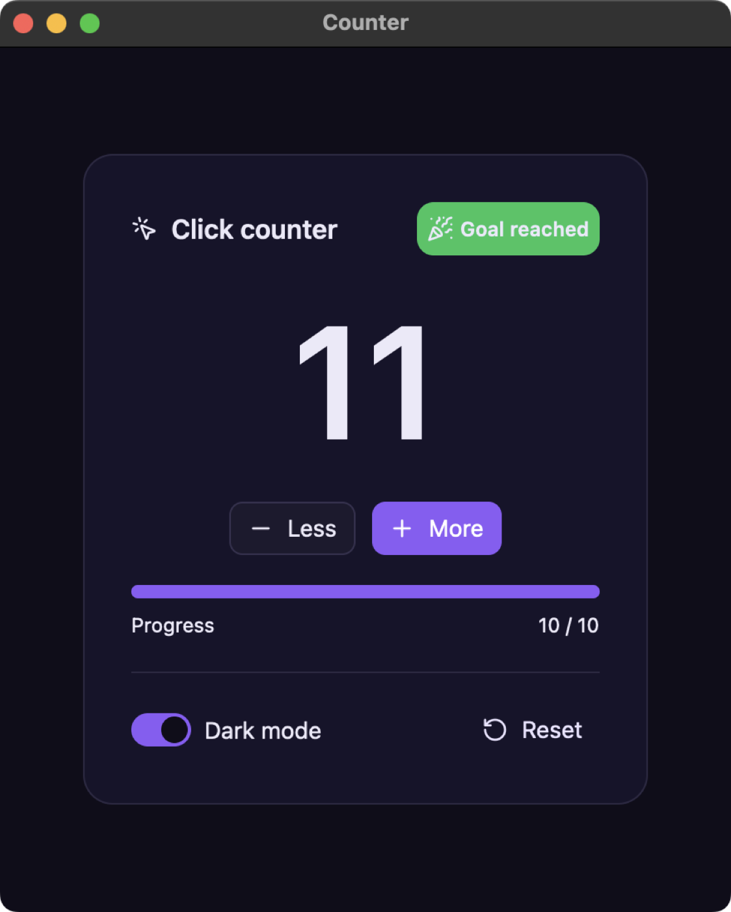
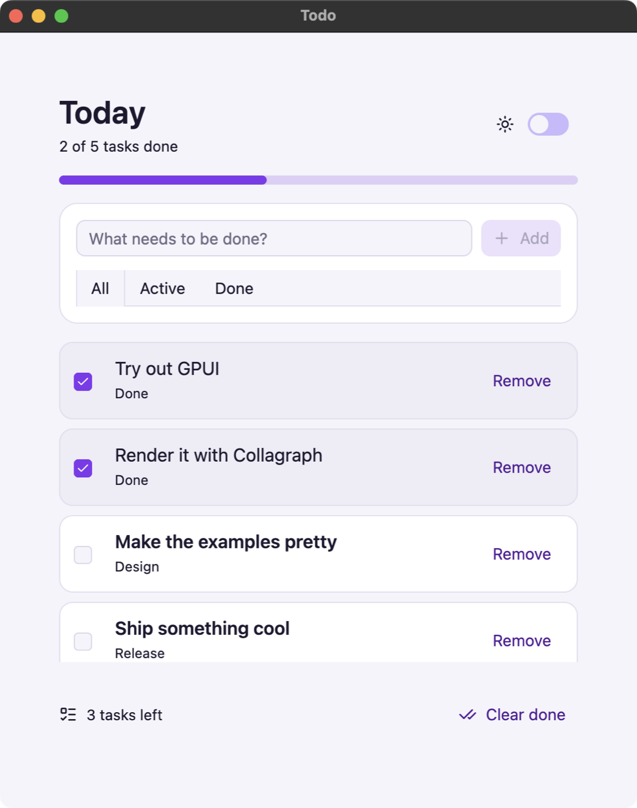
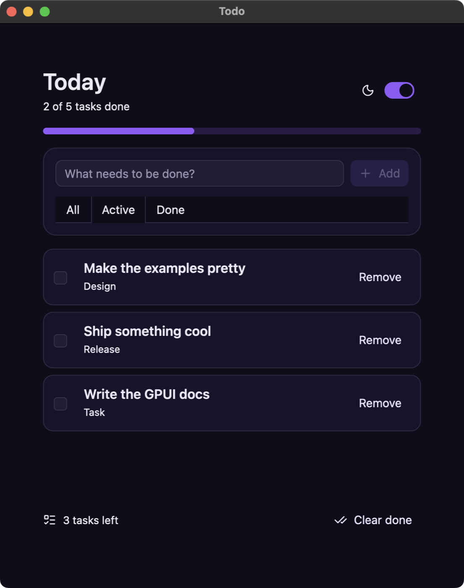
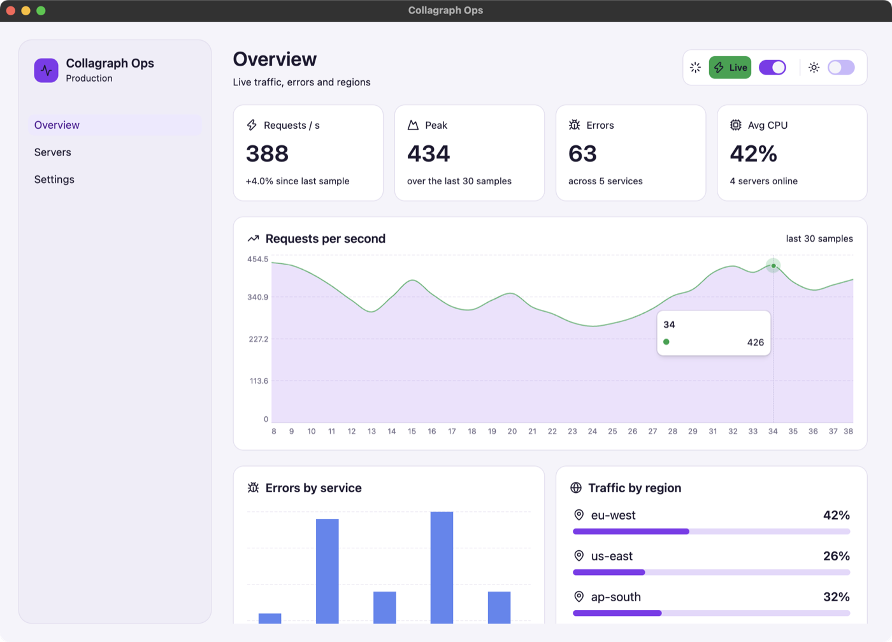
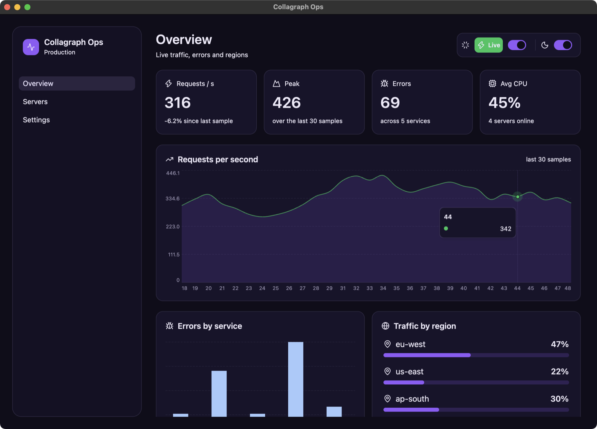
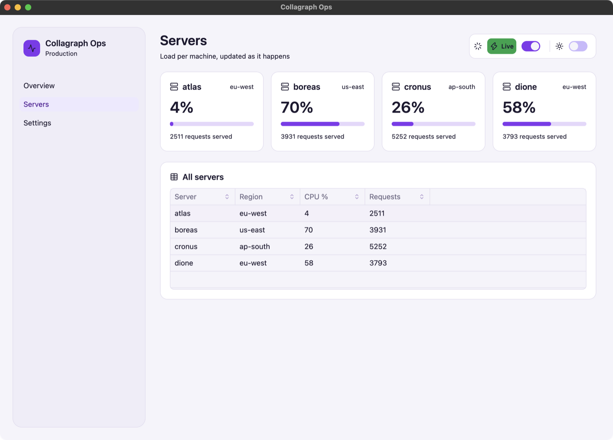
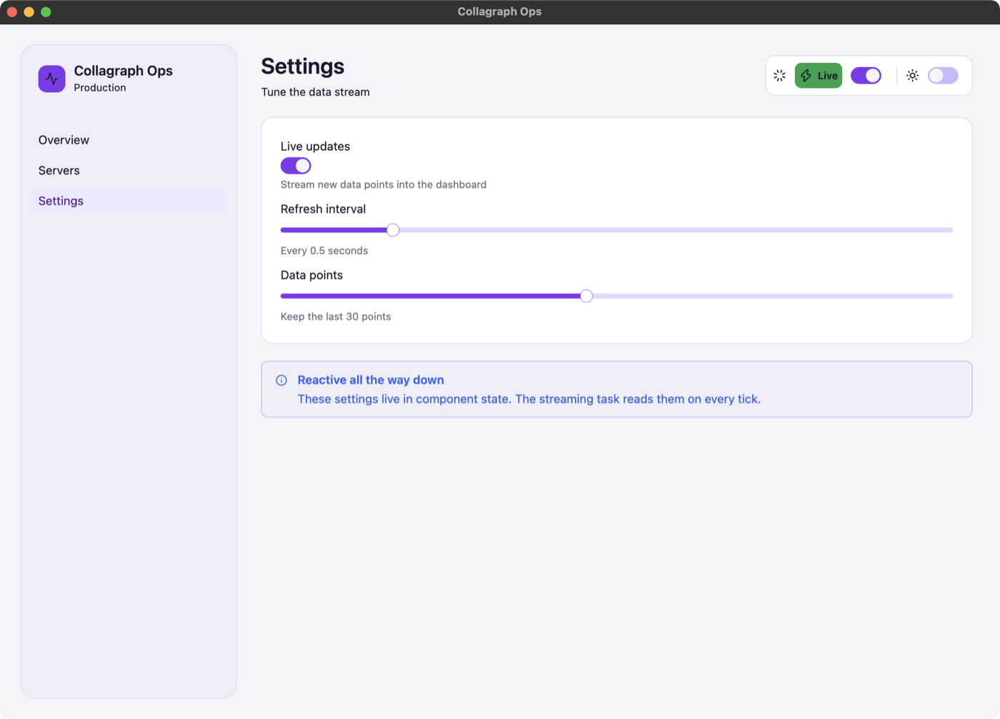

# GPUI Examples

These examples use the [GPUI renderer](../renderers/gpui.md). They live in `examples/gpui/` and run with:

```sh
uv run collagraph --renderer gpui examples/gpui/<file>.cgx
```

All examples share a violet theme with light and dark variants, defined in `examples/gpui/theme.py`. Each example has a switch that toggles dark mode through a reactive `:theme` binding on the `<window>` element.

## Counter

The essentials: a card with interpolated text, events, a bound `:disabled`, a progress bar and a goal pill that changes when the goal is reached.

{ width="49%" }
{ width="49%" }

```html title="counter.cgx (excerpt)"
<window title="Counter" :theme="theme(dark)" width="440" height="520">
  <column full-width full-height align="center" justify="center" padding="28">
    <column width="340" background="popover" border radius="18" padding="28" gap="18" align="center">
      <row full-width align="center" gap="8">
        <icon name="mouse-pointer-click" />
        <label bold flex="1">Click counter</label>
        <row :background="'success' if count >= GOAL else 'accent'" radius="10" padding="6" gap="4">
          <icon :name="'party-popper' if count >= GOAL else 'target'" />
          <label font-size="12" bold>{{ "Goal reached" if count >= GOAL else f"Goal {GOAL}" }}</label>
        </row>
      </row>
      ...
    </column>
  </column>
</window>
```

## Todo

A task list with a text input that adds on <kbd>Enter</kbd>, filter tabs and a keyed `v-for` of task cards. Each card has a checkbox and a remove button. The header shows overall progress, and an `<empty>` state appears through `v-if`. Computed values such as the filtered tasks are plain Python properties on the component.

{ width="49%" }
{ width="49%" }

```html title="todo.cgx (excerpt)"
<scroll flex="1">
  <column gap="8">
    <row
      v-for="todo in visible_todos"
      :key="todo['id']"
      :background="'muted' if todo['done'] else 'popover'"
      border radius="12" padding="12" gap="12" align="center"
    >
      <checkbox :value="todo['done']" @change="lambda done: set_done(todo, done)" />
      <column flex="1" gap="2">
        <label :bold="not todo['done']">{{ todo['text'] }}</label>
        <label font-size="12">{{ "Done" if todo['done'] else todo['tag'] }}</label>
      </column>
      <button variant="ghost" icon="trash-2" @click="lambda: remove(todo)">Remove</button>
    </row>
  </column>
</scroll>
```

```python
@property
def visible_todos(self):
    todos = self.state["todos"]
    if FILTERS[self.state["active_filter"]] == "Active":
        return [todo for todo in todos if not todo["done"]]
    ...
```

## Live Dashboard

An operations dashboard with a sidebar and three sections, switched with `v-if` / `v-else-if` / `v-else` on `<template>` elements:

- **Overview**: stat cards, a streaming area chart, errors per service and traffic per region
- **Servers**: a card per server with live CPU load, and a sortable table
- **Settings**: a form with sliders that control the data stream





{ width="49%" }
{ width="49%" }

The data comes from an asyncio task that starts in `mounted()`. The component is rendered on gpyui's callback loop, so a loop is running there. The task mutates reactive state, and every chart, card and table updates:

```python
def mounted(self):
    self._task = asyncio.get_running_loop().create_task(self.stream())

def before_unmount(self):
    self._task.cancel()

async def stream(self):
    while True:
        await asyncio.sleep(self.state["interval"])
        if self.state["live"]:
            self.update_data()
```

The layout keeps the sidebar in place while the content scrolls:

```html title="dashboard.cgx (excerpt)"
<window title="Collagraph Ops" :theme="theme(dark)" width="1180" height="820">
  <row full-width full-height min-height="0" align="stretch" gap="20">
    <column width="256" gap="6" background="sidebar" border radius="18">
      ...
      <sidebar :items="SECTIONS" :value="section" @change="set_section" height="140" />
    </column>
    <scroll flex="1" min-height="0">
      <column padding="8" gap="20">
        ...
        <column background="popover" border radius="14" padding="18" gap="12">
          <row align="center" gap="8">
            <icon name="trending-up" />
            <label bold flex="1">Requests per second</label>
          </row>
          <column height="240">
            <area-chart :data="traffic" />
          </column>
        </column>
      </column>
    </scroll>
  </row>
</window>
```
