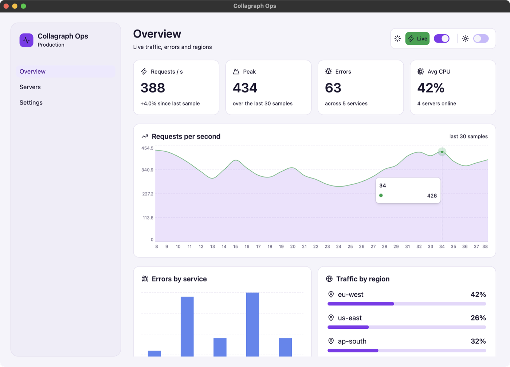
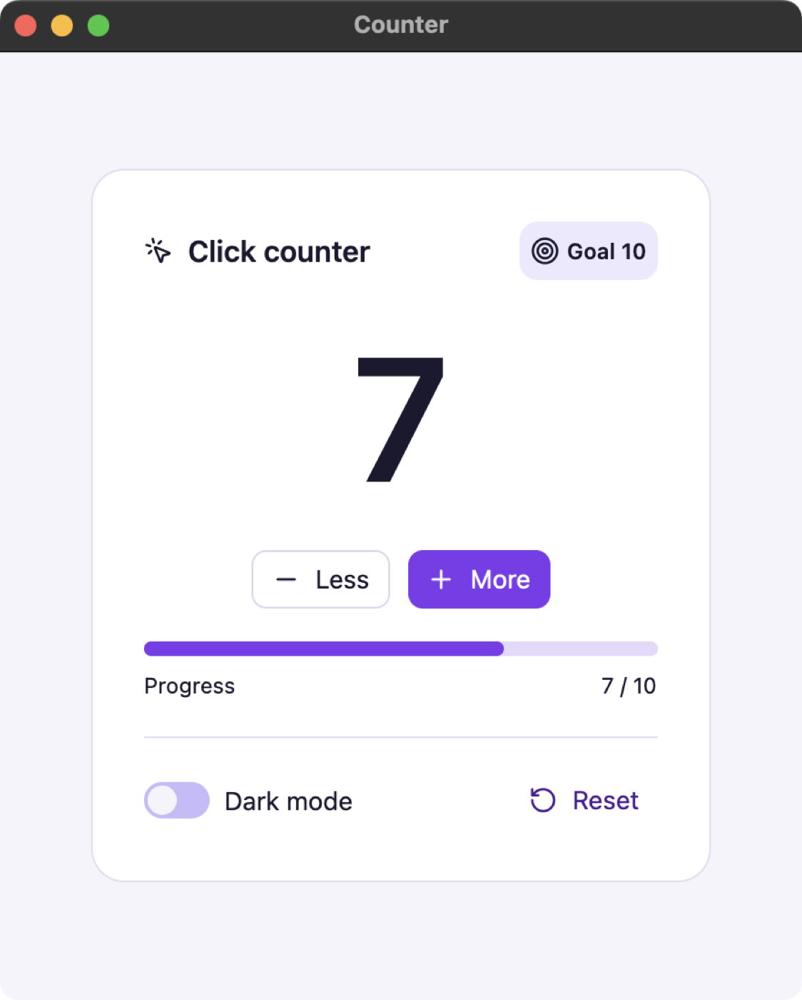
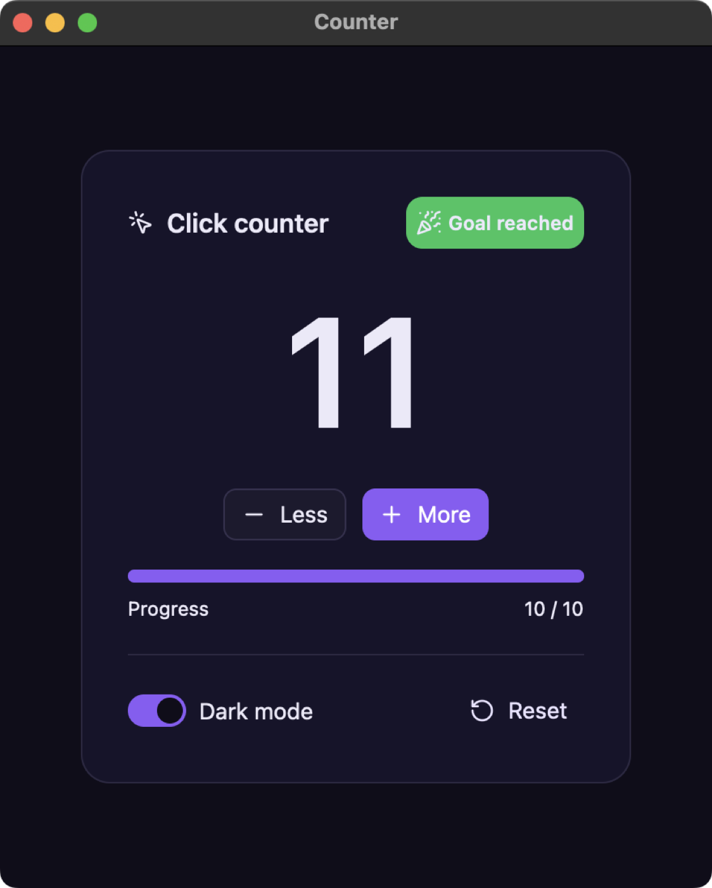

# GPUI Renderer

The `GpuiRenderer` renders components with [GPUI](https://github.com/zed-industries/zed/tree/main/crates/gpui), the GPU-accelerated UI framework that powers the [Zed](https://zed.dev) editor. It uses the [gpyui](https://github.com/gtrefalt/gpyui) Python bindings. These expose the native components of [GPUI Component](https://github.com/longbridge/gpui-component) (also known as GPUI Kit) as Python controls: buttons, inputs, sliders, tabs, tables, charts, forms, dialogs and more.

!!! note "Platform support"
    gpyui ships prebuilt wheels for **macOS** (arm64 and x86_64) and **Windows** (x64 and arm64). There are no Linux wheels, so the `gpui` extra installs nothing on Linux.



## Setup

```sh
pip install collagraph[gpui]
```

```python
import gpyui
import collagraph as cg

gui = cg.Collagraph(renderer=cg.GpuiRenderer())
app = gpyui.Application(
    title="Counter",
    width=480,
    height=320,
    # Render once the application runs: see "Threading" below
    on_start=lambda: gui.render(Counter, app),
)
app.run()
```

You can also run any `.cgx` file directly with the CLI:

```sh
uv run collagraph --renderer gpui examples/gpui/counter.cgx
```

!!! warning
    Keep a reference to the `Collagraph` instance (`gui` above) for as long as the application runs. Collagraph holds its fragment tree through weak references, so a discarded `Collagraph` instance stops updating.

## A First Component

```html title="counter.cgx"
<window title="Counter" :theme="theme(dark)" width="440" height="520">
  <column full-width full-height align="center" justify="center" padding="28">
    <column width="340" background="popover" border radius="18" padding="28" gap="18" align="center">
      <!-- Large text overflows its line box, so give it room -->
      <column height="112" justify="center" align="center">
        <label font-size="96" bold>{{ count }}</label>
      </column>
      <row gap="10">
        <button icon="minus" @click="decrement" :disabled="count == 0">Less</button>
        <button variant="primary" icon="plus" @click="increment">More</button>
      </row>
      <progress :value="min(count, GOAL) / GOAL * 100" />
      <switch :value="dark" @change="set_dark" text="Dark mode" />
    </column>
  </column>
</window>

<script>
import collagraph as cg

from examples.gpui.theme import theme

GOAL = 10


class Counter(cg.Component):
    def init(self):
        self.state["count"] = 0
        self.state["dark"] = False

    def increment(self):
        self.state["count"] += 1

    def decrement(self):
        self.state["count"] = max(0, self.state["count"] - 1)

    def set_dark(self, value):
        self.state["dark"] = value
</script>
```

{ width="49%" }
{ width="49%" }

## Available Elements

Every control that gpyui exports can be used as a tag. The tag is the class name, case-insensitive, with optional dashes or underscores. So `<text-input>`, `<textinput>` and `<TextInput>` all create a `gpyui.TextInput`.

| Category | Tags |
|----------|------|
| Layout | `<column>`, `<row>`, `<container>`, `<scroll>`, `<resizable>`, `<group-box>`, `<toolbar>`, `<status-bar>`, `<collapsible>`, `<carousel>` |
| Text | `<label>`, `<markdown>`, `<html>`, `<kbd>`, `<link>`, `<message>`, `<bubble>`, `<marker>` |
| Buttons & toggles | `<button>`, `<checkbox>`, `<radio>`, `<switch>`, `<toggle>`, `<dropdown-menu>` |
| Input | `<text-input>`, `<text-area>`, `<editor>`, `<number-input>`, `<otp-input>`, `<slider>`, `<rating>`, `<color-picker>`, `<calendar>`, `<date-picker>`, `<time-field>` |
| Selection | `<select>`, `<combobox>`, `<multi-select>`, `<radio-group>`, `<tabs>`, `<sidebar>`, `<list>`, `<tree>`, `<stepper>`, `<breadcrumb>`, `<pagination>`, `<accordion>`, `<command-palette>` |
| Data | `<table>`, `<description-list>`, `<line-chart>`, `<area-chart>`, `<bar-chart>`, `<pie-chart>`, `<candlestick-chart>` |
| Feedback | `<alert>`, `<badge>`, `<tag>`, `<progress>`, `<progress-circle>`, `<spinner>`, `<skeleton>`, `<shimmer>`, `<empty>` |
| Overlays | `<dialog>`, `<sheet>`, `<popover>`, `<hover-card>`, `<tooltip>` |
| Forms | `<form>`, `<field>` |
| Other | `<avatar>`, `<icon>`, `<image>`, `<separator>`, `<attachment>`, `<clipboard>` |

There are a few short aliases as well: `<input>` and `<lineedit>` (`TextInput`), `<text>` (`Label`), `<vbox>` (`Column`), `<hbox>` (`Row`), `<scrollarea>` (`Scroll`), `<progressbar>` (`Progress`) and `<spinbox>` (`NumberInput`).

See the [gpyui documentation](https://gtrefalt.github.io/gpyui/) for each control's properties.

### Custom Elements

Register your own `gpyui.Control` subclasses with `register_element`. The supported attributes and events are derived from the class:

```python
import gpyui
from collagraph import GpuiRenderer


@GpuiRenderer.register_element("card")
class Card(gpyui.Container):
    pass
```

## Attributes

Attributes map onto the keyword arguments and properties of gpyui controls:

```html
<slider :value="volume" minimum="0" maximum="11" step="0.5" />
<radio-group :items="['Small', 'Medium', 'Large']" :value="size" />
<text-input placeholder="Search..." clearable :disabled="busy" />
```

Static attributes are strings in templates. The renderer converts them to the type of the property: numbers for numeric properties, and booleans for boolean properties. A bare attribute such as `disabled` or `clearable` means `True`. Properties without a default value of their own, like the `minimum` of a `<number-input>`, are not converted, so bind those with `:minimum="5"`.

Collagraph sets attributes one at a time, but gpyui validates some properties together. For example, the `value` of a `<radio-group>` must be a valid index into its `items`. To handle this, the renderer collects all attributes of an element and only constructs the gpyui control when the element is inserted into the tree. Related properties are therefore validated together. Properties that gpyui only accepts at construction time (such as the range of a `<slider>` or the `columns` of a `<table>`) work too: when you bind one to a changing value, the renderer transparently replaces the control. It keeps the control's position, children and any unbound native state (such as text the user typed).

### Layout and Style

The layout and style properties of gpyui can be set as individual attributes or through a `style` dict:

```html
<column gap="12" padding="24" full-height>
  <label font-size="20" bold>Title</label>
  <row :style="{'gap': 8, 'align': 'center', 'background': 'muted'}">...</row>
</column>
```

| Property | Type |
|----------|------|
| `width`, `height`, `min-width`, `min-height` | pixels |
| `padding`, `gap`, `radius`, `font-size` | pixels |
| `flex` | number (grow factor) |
| `full-width`, `full-height`, `border`, `bold` | bool |
| `background` | theme token, e.g. `popover`, `muted`, `primary`, `accent`, `success`, `sidebar`, `border` |
| `color` | theme token (not rendered by gpyui 0.6, see [Limitations](#limitations)) |
| `align` | `start`, `center`, `end`, `stretch` |
| `justify` | `start`, `center`, `end`, `between` |

Use the `visible` attribute to hide a control without removing it from the tree. Use `v-if` to remove it completely.

### Text Content

Text inside a control that has a `text` property becomes the text of that control. This includes `<label>`, `<button>`, `<checkbox>`, `<markdown>` and `<tag>`:

```html
<label>Count: {{ count }}</label>
<button @click="save">Save {{ name }}</button>
<markdown>**Bold** and _italic_</markdown>
```

Text placed directly inside a container (such as `<column>`) is shown with a `Label`.

## Events

Listen to the events a control supports with `@event`. The handler receives the event's value, such as the new value of a slider or the text of an input. Events without a value, such as a button click, call the handler without arguments:

```html
<button @click="increment">+1</button>
<slider :value="volume" @change="set_volume" />
<text-input :value="query" @change="set_query" @submit="search" />
<checkbox :value="todo['done']" @change="lambda done: set_done(todo, done)" />
```

```python
def set_volume(self, value):
    self.state["volume"] = value
```

| Control | Events |
|---------|--------|
| `<button>`, `<link>` | `click` |
| `<text-input>` | `change`, `submit`, `focus`, `blur` |
| `<slider>` | `change`, `release` |
| `<table>` | `change` (selected row), `sort` |
| `<command-palette>` | `query`, `cancel` |
| `<image>` | `load`, `error` |
| `<resizable>` | `resize` |
| other value controls | `change` |

Using an event that a control does not support raises a `ValueError` that lists the supported events.

gpyui updates a control's value with native edits before it calls the handlers. If the user drags a slider, `slider.value` already has the new value, so binding `:value` back to the same state does not cause a feedback loop.

## Template Refs

Template refs point to a `GpuiElement` handle. Its `control` attribute holds the gpyui control once the element is mounted:

```html
<dialog ref="dialog" title="Confirm">...</dialog>
<button @click="lambda: dialog.control.open()">Open</button>
```

## Threading

GPUI owns the main thread while `app.run()` runs. gpyui calls Python callbacks on an asyncio event loop in a separate worker thread, and all changes to controls must happen on that loop.

The renderer integrates collagraph's scheduler with that loop:

- Reactive updates are flushed on gpyui's callback loop.
- Updates from other threads are passed to the loop with `app.call_soon()`.
- Updates made before `app.run()` (when there is no loop yet) are flushed immediately.

That is why rendering in `on_start` is recommended. The component's `init()` and `mounted()` hooks then run on the callback loop, where they can start asyncio tasks:

```python
class Clock(cg.Component):
    def mounted(self):
        self._task = asyncio.get_running_loop().create_task(self.tick())

    def before_unmount(self):
        self._task.cancel()

    async def tick(self):
        while True:
            await asyncio.sleep(1)
            self.state["now"] = datetime.now().strftime("%H:%M:%S")
```

Rendering before `app.run()` (`gui.render(App, app); app.run()`) works as well. In that case `mounted()` runs on the main thread without a running event loop.

Hot reload (`collagraph -H --renderer gpui ...`) schedules reloads on the callback loop as well.

!!! note
    GPUI exits the process when its window closes, so code after `app.run()` does not run. Use `Application(on_error=...)` or gpyui's command and menu APIs for cleanup and error reporting.

## The Window

`gpyui.Application` is the window: render your root component into it. gpyui currently supports a single window per process.

Use a `<window>` element as the root of your template to configure the application from the template. Its `title`, `theme`, `width` and `height` attributes map onto the application, and its children become the root controls:

```html
<window :title="f'{unread} unread'" :theme="'dark' if dark else 'light'" width="900" height="600">
  ...
</window>
```

All of these can be bound, so a dark mode switch is a single reactive attribute. `theme` accepts `"light"`, `"dark"`, a preset name (`"macos"`, `"windows"`, `"shadcn-zinc"`, `"shadcn-blue"`) or a `gpyui.Theme`. `<window>` can only be rendered into a `gpyui.Application`.

## Theming

gpyui themes are `gpyui.Theme` objects: a preset plus optional overrides of semantic colors, radii and fonts. The examples share a violet theme with light and dark variants (`examples/gpui/theme.py`):

```python
import gpyui

theme = gpyui.Theme(
    "shadcn-zinc",
    mode="dark",
    colors={
        "background": "#0f0d1a",
        "foreground": "#ece9f8",
        "primary": "#8b5cf6",
        "primary_foreground": "#ffffff",
        "popover": "#17142a",  # used for cards in the examples
        "sidebar": "#141124",
        ...
    },
    radius=8,
    radius_lg=14,
)
```

!!! tip
    With gpyui's unthemed `default` preset, the text on `variant="primary"` buttons is nearly invisible (dark on dark). Use one of the other presets, or set `primary_foreground` in a custom theme.

The `background` style property takes the same semantic tokens, which makes cards easy:

```html
<column background="popover" border radius="14" padding="18" gap="12">...</column>
```

## Layout Tips

GPUI uses flexbox layout. A few things learned while building the examples:

- **Fill the window and scroll:** give the root `full-width full-height` and put long content in `<scroll flex="1" min-height="0">`. Without `min-height="0"`, the content grows the layout past the window instead of scrolling.
- **Stretch siblings:** rows center their children vertically by default. Use `align="stretch"` to give cards in a row the same height (or a sidebar the full height).
- **Large text:** labels keep the regular line height when you increase `font-size`, so big text overflows into its neighbours. Wrap it in a container with a fixed height: `<column height="112" justify="center"><label font-size="96">...</label></column>`.
- **Dividers:** `<column full-width height="1" background="border" />` makes a clean divider line.
- **Spacers:** an empty `<column flex="1" />` pushes the following siblings to the end.

## Limitations

Some limitations come from gpyui 0.6 itself:

- The `color` style property is accepted, but not rendered: text always uses the theme's foreground color.
- Some Kit widgets ignore size styles: `<progress-circle>` and `<tag>` keep their own size, and `<sidebar>` fills the available height (give it an explicit `height`).
- All `<pie-chart>` slices use the same color, so progress bars per category usually read better.

Other limitations:

- Each `<dialog>` or `<sheet>` needs to be the only one of its kind in the window.
- gpyui limits an application to 10,000 controls and a nesting depth of 64.
- Removing an element detaches its control and disposes it at the end of the event loop tick. Elements that are moved (in a keyed `v-for`) keep their control.
- The renderer is tested against gpyui 0.6.
